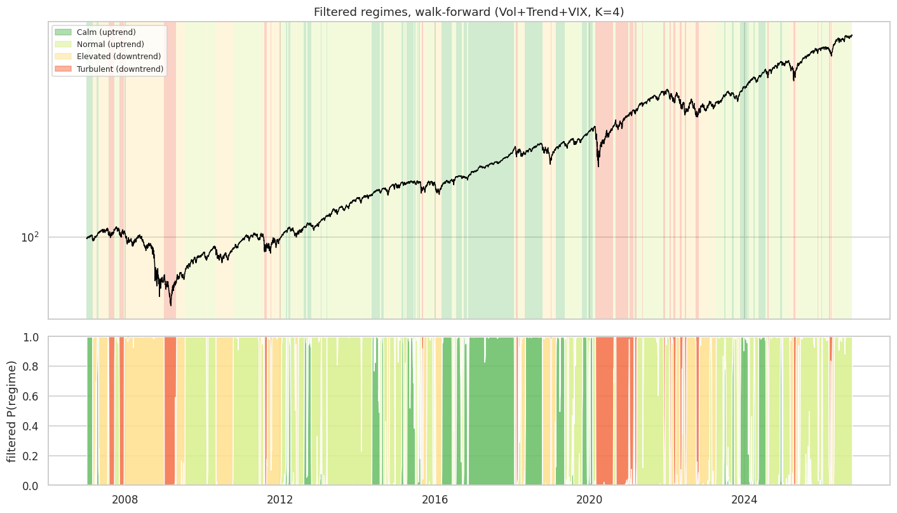
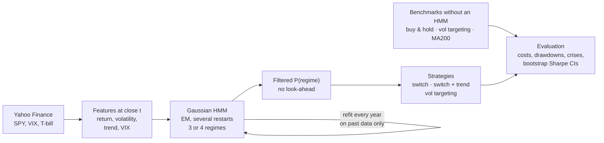
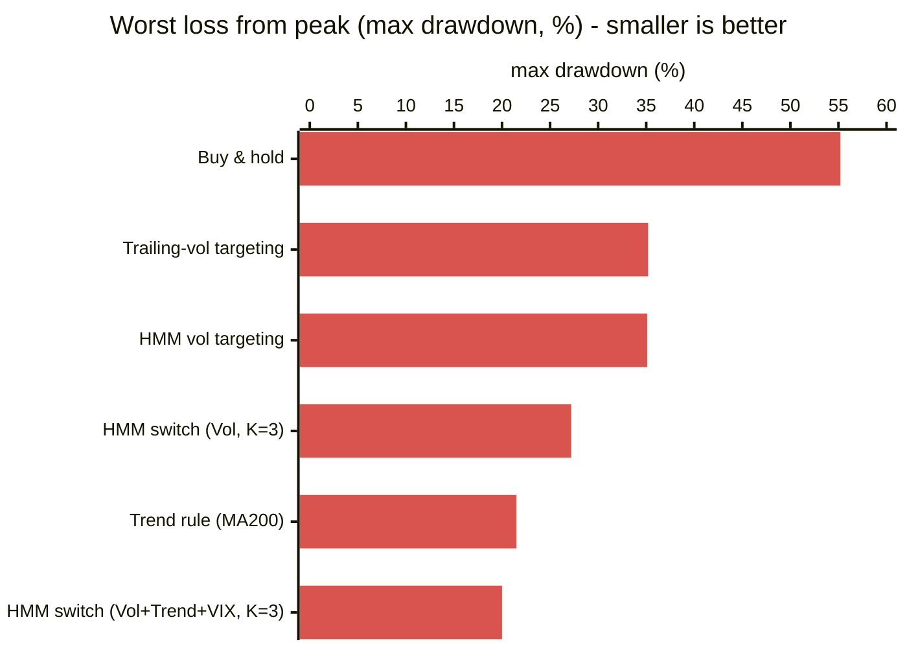
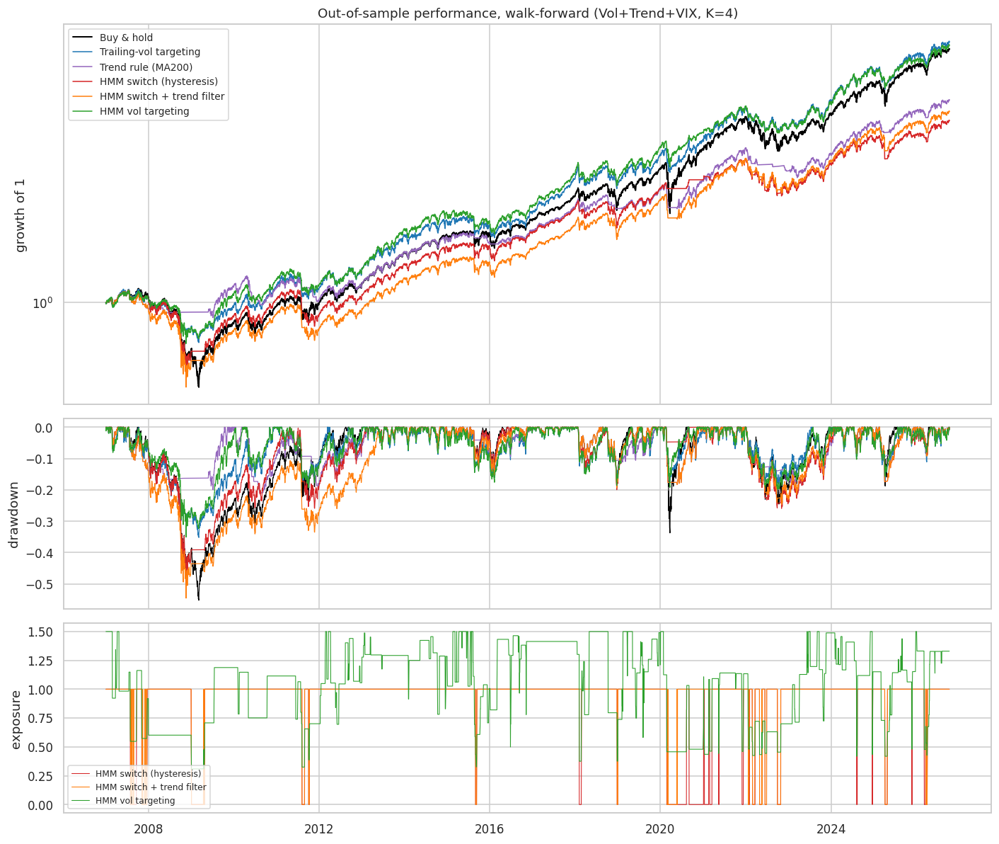
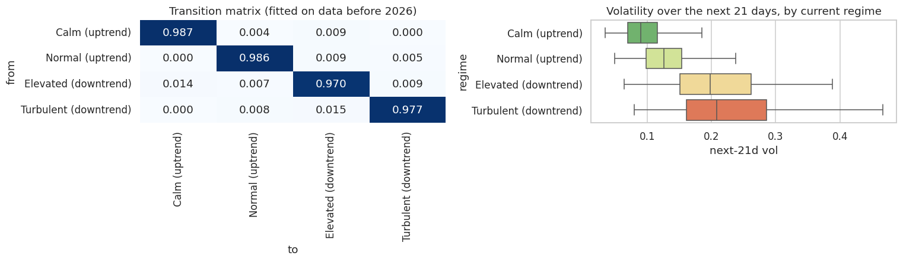

# Market Regime Detection with Hidden Markov Models

**Can a model that detects calm and turbulent market phases build a better S&P 500 portfolio than simple rules? Tested honestly over 20 years out of sample: it halves the worst crash loss, but it doesn't beat simple rules with statistical significance.**


*The S&P 500 (SPY) coloured by the regime the model detected each day, using only data available at that date.*

## Highlights

- **Gaussian HMMs** find 4 market regimes (calm, normal, elevated, turbulent) from returns, volatility, trend and the VIX.
- **No look-ahead anywhere:** yearly walk-forward refits from 2007 to 2026, and positions use filtered probabilities (past data only).
- **Realistic backtest:** transaction costs, T-bill interest on cash, borrowing costs, and benchmarks that need no model.
- **Statistical rigour:** block-bootstrap confidence intervals on every Sharpe-ratio difference, and a check that each strategy beats a constant portfolio with the same average exposure.

**Stack:** Python · hmmlearn (plus a NumPy HMM fallback) · pandas · NumPy · SciPy · scikit-learn · yfinance · Matplotlib

## Pipeline



## Results

Out of sample from **2007-01-04 to 2026-10-09** (19.7 years), 5 bps costs, cash earning the T-bill rate.





### Key findings

- **The regimes are real.** The detected regime predicts next-month volatility, which rises steadily from calm (9.9%) to turbulent (24.6%).
- **Crash risk drops sharply.** HMM strategies cut the maximum drawdown from −55% to as little as −20%, and far below a constant portfolio with the same average exposure (−27% vs −47%), so the timing itself does the work.
- **Rebounds are the price.** Stepping out during turbulence also misses recoveries: +1.7% for the HMM switch in the COVID rebound vs +52.6% for buy & hold.
- **Simple rules are hard to beat.** The best HMM Sharpe ratio (0.70) is close to volatility targeting (0.67) and the 200-day trend rule (0.64), which need no model.
- **Nothing is statistically significant.** None of the 9 bootstrap comparisons for the main model has a 95% interval that excludes zero.

### Benchmarks and best HMM strategies

| Strategy | Config | CAGR | Vol | Sharpe | Max drawdown | Avg exposure | Same-exposure max DD |
|---|---|---:|---:|---:|---:|---:|---:|
| Buy & hold | – | 11.03 % | 19.5 % | 0.55 | −55.2 % | 100 % | −55.2 % |
| Trailing-vol targeting | – | 11.38 % | 15.5 % | 0.67 | −35.2 % | 109 % | −58.7 % |
| Trend rule (MA200) | – | 8.73 % | 11.8 % | 0.64 | −21.5 % | 79 % | −45.9 % |
| HMM switch (hysteresis) | Vol, K=3 | 9.74 % | 12.2 % | **0.70** | −27.2 % | 81 % | −46.6 % |
| HMM switch (hysteresis) | Vol+Trend+VIX, K=3 | 7.10 % | 10.6 % | 0.55 | **−20.0 %** | 71 % | −41.8 % |
| HMM vol targeting | Vol+Trend+VIX, K=4 | 11.22 % | 15.4 % | 0.67 | −35.1 % | 105 % | −57.1 % |

The notebook reports all 12 HMM strategy/configuration combinations alongside the three benchmarks.

<details>
<summary>Regimes found, crisis episodes and transition matrix</summary>

### Regimes found by the main model (Vol+Trend+VIX, 4 regimes)

| Regime | Share of test days | Expected duration | Ann. vol (same day) | Next-21-day vol |
|---|---:|---:|---:|---:|
| Calm (uptrend) | 21.6 % | 77 days | 7.8 % | 9.9 % |
| Normal (uptrend) | 44.3 % | 71 days | 12.6 % | 13.5 % |
| Elevated (downtrend) | 23.2 % | 33 days | 27.0 % | 23.0 % |
| Turbulent (downtrend) | 11.0 % | 44 days | 34.2 % | 24.6 % |

The filtered regimes clearly separate future risk: volatility over the next 21 days rises steadily from the calm to the turbulent regime.



### Crisis episodes (main model)

| Episode | Buy & hold | Trailing-vol | Trend rule | HMM switch | HMM vol targeting |
|---|---:|---:|---:|---:|---:|
| 2008 crisis | −55.2 % | −35.1 % | −13.2 % | −37.4 % | −32.1 % |
| 2009 rebound | +67.4 % | +32.6 % | +22.3 % | +31.8 % | +42.0 % |
| COVID crash | −33.7 % | −17.8 % | −17.6 % | −4.7 % | −19.2 % |
| COVID rebound | +52.6 % | +20.4 % | +12.8 % | +1.7 % | +22.5 % |
| 2022 bear market | −24.5 % | −18.1 % | −13.8 % | −24.2 % | −19.7 % |
| 2025 sell-off | −18.8 % | −16.6 % | −9.3 % | −17.3 % | −14.7 % |

</details>

<details>
<summary>Full methodology</summary>

### 1. Data
| Series | Ticker | Use |
||||
| S&P 500 ETF (adjusted close) | `SPY` | returns, volatility, trend |
| CBOE Volatility Index | `^VIX` | implied (forward-looking) volatility |
| 13-week T-bill yield | `^IRX` | return on cash, cost of borrowing, excess returns |

Daily data from 2000-01-01, downloaded with `yfinance`. The notebook has fallbacks so that every cell still runs:
- no VIX → a realised-volatility proxy;
- no T-bill → cash earns 0 %;
- no internet → a **synthetic** market simulated from a known 4-regime Markov chain (clearly flagged, and the true regimes are used as a sanity check).

### 2. Features
All features are known at the close of day *t*:

| Feature | Definition | Why |
||||
| `ret` | daily log return | direction of the market |
| `log_vol` | log of 10-day realised volatility (annualised) | recent risk |
| `trend` | log price − log 200-day moving average | separates falling markets from rebounds |
| `log_vix` | log of the VIX | the market's *expected* volatility |

Two feature sets are compared: **Vol** (`ret`, `log_vol`) and **Vol+Trend+VIX** (all four). Each refit standardises the features using only its own training window.

### 3. Gaussian HMM
- Hidden regime *s<sub>t</sub>* follows a Markov chain with transition matrix *A*; observations are Gaussian with full covariance per regime.
- Fitted by EM (Baum–Welch) with several random restarts, using `hmmlearn` when available and a pure NumPy implementation otherwise (k-means initialisation, scaled forward–backward).
- **Filtered** probabilities (forward recursion, past and present only) drive the strategies. **Smoothed** probabilities (whole sample) are only used for description.
- States are sorted by mean volatility, so state 0 is always the calmest.

### 4. Model selection
BIC is computed for 2, 3 and 4 regimes on the first training window (2000–2006) only. With daily data, BIC keeps rewarding more states (4 is preferred for both feature sets). For that reason the four tested configurations — {Vol, Vol+Trend+VIX} × {3, 4 regimes} — and the main model (**Vol+Trend+VIX, 4 regimes**) were fixed **before** looking at test results.

### 5. Walk-forward estimation
For every year *Y* from 2007, each configuration is refitted on all data before 1 January of *Y* and run forward through *Y* (20 refits per configuration). The per-regime volatilities used by the vol-targeting rule are re-estimated in the same window. Nothing from year *Y* is used before it happens.

### 6. Strategies and benchmarks

| Strategy | Exposure decided at the close of day *t* |
|||
| **HMM switch (hysteresis)** | leave the market when P(most turbulent) > 0.7, return when it falls below 0.3 |
| **HMM switch + trend filter** | out only if P(most turbulent) > 0.5 **and** price is below its 200-day average |
| **HMM vol targeting** | min(1.5, 15 % / σ̂<sub>t</sub>), with σ̂<sub>t</sub> = Σ<sub>k</sub> P(k) · σ<sub>k</sub> |
| Buy & hold | always 100 % invested |
| Trailing-vol targeting | min(1.5, 15 % / 21-day realised vol) |
| Trend rule (MA200) | invested only when price is above its 200-day average |

Accounting:
- uninvested cash earns the T-bill rate; exposure above 100 % pays T-bill + 0.5 %;
- 5 bps cost per unit of turnover (sensitivity tested at 0, 5, 10, 25 bps);
- vol-targeting rules only rebalance when the target moves by more than 10 points;
- Sharpe and Sortino use returns in excess of the T-bill.

**Same-exposure check.** Each strategy is compared with a portfolio holding its *average* exposure constantly. If regime timing adds value, the strategy should beat that constant mix on return or drawdown.

### 7. Significance
Daily returns have clustered volatility, so a plain bootstrap would understate uncertainty. A **circular block bootstrap** (21-day blocks, 2 000 resamples, both strategies resampled jointly) gives a 95 % confidence interval for each Sharpe-ratio difference.

</details>

## How to run

```bash
pip install -r requirements.txt
jupyter notebook market-regime-detection.ipynb
```

- `hmmlearn` is optional (the NumPy HMM is used without it, but the walk-forward is slower).
- The full walk-forward takes about 5 minutes on a CPU with `hmmlearn`.
- The notebook also runs on Kaggle or Colab; the first cell installs `yfinance` and `hmmlearn` if they are missing.
- Figures and tables (CSV) are written to an `outputs/` folder.

## Main parameters

All settings are at the top of the notebook:

| Parameter | Default | Meaning |
|---|---|---|
| `TEST_START` | `2007-01-01` | start of the out-of-sample period |
| `CONFIGS` | 2 feature sets × {3, 4} regimes | configurations evaluated |
| `MAIN_CONFIG` | `("Vol+Trend+VIX", 4)` | model analysed in detail |
| `EXIT_P`, `ENTER_P` | 0.7, 0.3 | hysteresis thresholds for the switch strategy |
| `TARGET_VOL`, `MAX_LEVERAGE` | 15 %, 1.5 | vol-targeting settings |
| `COST_BPS` | 5 | transaction cost per unit of turnover |
| `BOOT_N`, `BOOT_BLOCK` | 2000, 21 | bootstrap resamples and block length |
